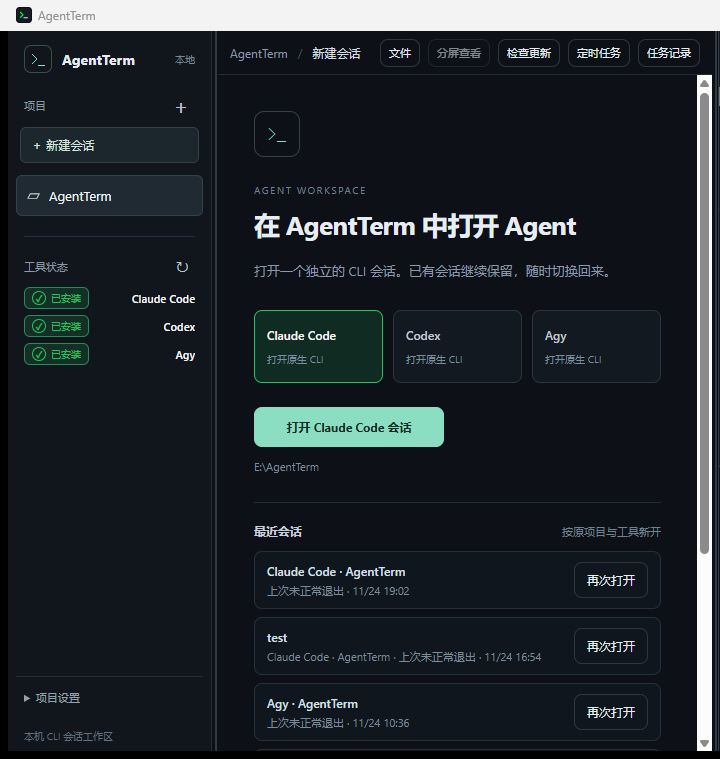
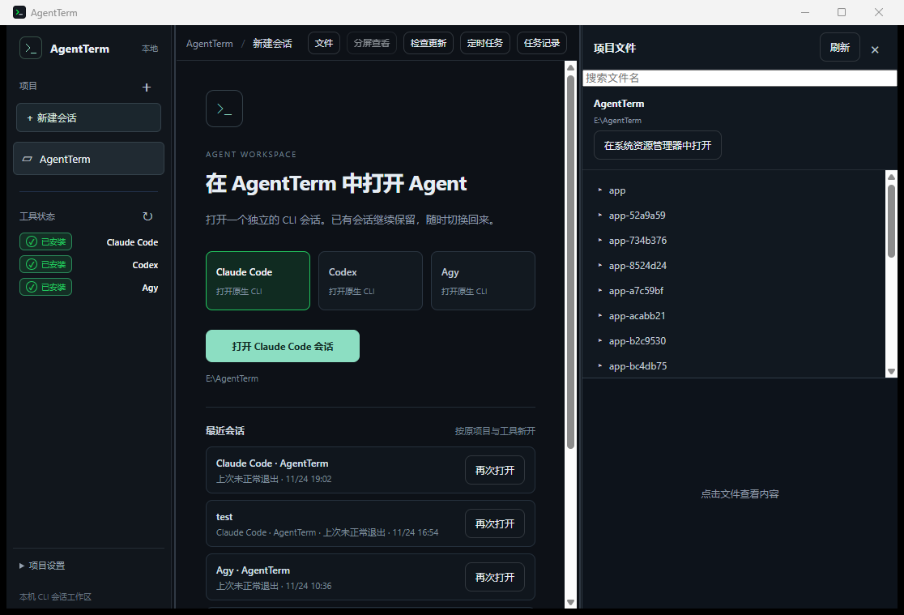
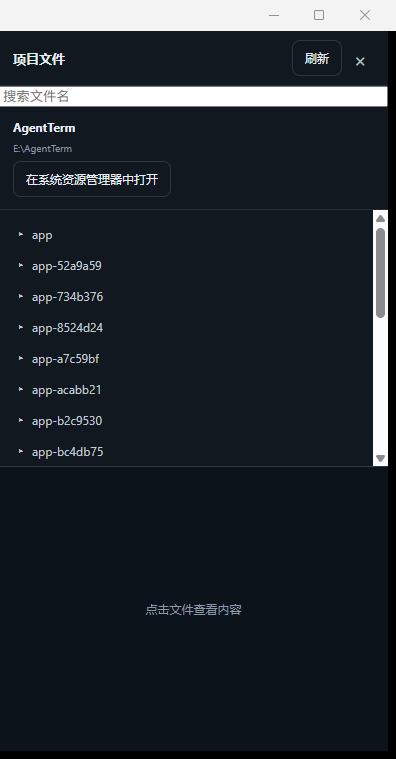

# AgentTerm

AgentTerm 是一个本地优先的桌面 Agent 会话工作台。它把 Claude Code、Codex
和 Agy 放进统一的项目、标签页和文件工作区，并让 Agent 在对话中创建可管理、
可定时执行的本地任务。

当前版本是**公开测试版**。Windows x64 已有可安装包；macOS Apple Silicon
安装包会随测试版构建发布，但尚未完成同等强度的真机验收。安装包未签名或公证，
Windows 首次运行时可能出现 SmartScreen 提示。

[下载最新测试版](https://github.com/SophiaData/AgentTerm/releases) ·
[查看当前开发状态](docs/tasks.md) ·
[参与贡献](CONTRIBUTING.md) ·
[安全说明](SECURITY.md)



## 现在能做什么

| 已支持                                                     | 尚未支持                              |
| ---------------------------------------------------------- | ------------------------------------- |
| Windows x64 安装与更新检查                                 | 外部 Windows Terminal 会话接管        |
| 同一窗口保留多个 Claude Code / Codex / Agy 会话            | 把任意 CLI 原生对话断点恢复为同一进程 |
| 项目文件树、只读文本预览和资源管理器入口                   | 文件编辑、删除、重命名                |
| WebView 重载或窗口恢复后对账存活 PTY                       | macOS 原生实机验收、签名和公证        |
| Agent 通过会话工具创建定时任务，工作台管理、暂停和立即运行 | 任意 `.cmd` / `.bat` 静默调度         |
| 单主任务账本、恢复核实和完成后显式释放                     | 通用持久任务队列和外部生产作业撤销    |



## 安装

系统要求：

- Windows 10/11 x64，已安装 WebView2；
- 需要使用的 CLI 已安装并完成各自的账号登录：Claude Code、Codex 或 Agy；
- 从 Release 的 **Assets** 下载文件名以 `windows-x64-setup.exe` 结尾的安装包。

macOS 预览包要求 Apple Silicon；当前测试版不提供 Intel Mac 包。



AgentTerm 不读取或复制 CLI 账号凭据。Claude Code、Codex、Agy
继续使用本机各自的原生配置、登录状态和权限策略，定时任务也不会替 Agent
自动批准权限。

## 本地开发

需要 Node.js 22.13+、pnpm、Rust 1.90+、Python 3，以及对应平台的 Tauri
系统依赖。

```bash
pnpm install
pnpm dev:app
```

提交前运行：

```bash
pnpm check
```

完整测试优先由 GitHub Actions 在 Linux、macOS 和 Windows 上执行；桌面与 TUI
打包使用独立 job，可在质量门通过后并行运行。项目结构、存储边界和原生验收
记录分别见 [架构说明](docs/architecture.md)、
[测试记录](docs/testing.md) 和 [任务日志](docs/task-log/2026-11.md)。

## 许可证

AgentTerm 使用 [MIT License](LICENSE)。
